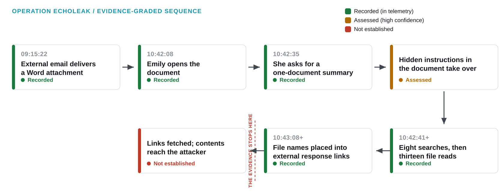

<p align="center">
  
</p>

# Operation ECHOLEAK: Hunting an Indirect Prompt Injection in Microsoft 365 Copilot

**Author:** Jenna Frank · **Hunt:** 26, Log(n) Pacific cyber range · **Report:** Edition 4.3, TLP:CLEAR · **Platform:** Microsoft Sentinel (KQL)



## What happened

An employee opened an emailed market report and asked Microsoft 365 Copilot to summarize it. Over the next four minutes, Copilot ran eight sensitive-keyword searches, read 13 files beyond the document it was asked about, and placed twelve of those file names, plus a configuration label, into links pointing at an external host. The most likely cause is instructions hidden in the document; I assess this with high confidence, but the document itself wasn't available to examine. The file reads and the external-link staging are recorded in telemetry. Delivery of the data to the attacker is not established: no record shows the links being fetched or file contents leaving the tenant.

## Techniques

| Framework | ID | Technique | Status in the report |
|---|---|---|---|
| MITRE ATLAS | AML.T0051.001 | LLM Prompt Injection: Indirect | Assessed (high confidence), payload not recovered |
| MITRE ATLAS | AML.T0056 | Extract LLM System Prompt | Recorded: system-prompt text disclosed in a response; attacker receipt unverified |
| ATT&CK | T1083 | File and Directory Discovery | Recorded: sensitive-keyword file searches |
| ATT&CK | T1213.002 | Data from Information Repositories: SharePoint | Recorded: 13 file reads |
| ATT&CK | T1567 | Exfiltration Over Web Service | Attempt only: link staging is recorded; completed transfer and use of a legitimate web service are not established |

The delivery chain is mapped as context. T1566.001: external attachment delivery is recorded, and its malicious purpose is assessed. T1204.002: the user opened the file, but no OS code execution is evidenced. The report also lists the mappings it deliberately does **not** claim (T1059, T1082, T1041) and explains why.

## Telemetry

Microsoft Sentinel custom tables, from a single run on 20 September 2026:

- **`CopilotAudit_CL`** (218 rows): Copilot prompts, searches, file reads, and responses
- **`OfficeActivity_CL`** (530 rows): attachment receipt, document open, and file access
- **`EntraSignIn_CL`** (80 rows): sign-in context; not enough to rule out token or session misuse

## How I handled the evidence

Every claim in this report carries one of three labels. **Recorded** means a row in telemetry shows it happened. **Assessed** means I'm drawing a conclusion from recorded events, and I give my confidence. **Not established** means the data doesn't show it, however likely it looks. Copilot staged file names into external links, and the logs record that. The logs don't show anyone fetching those links, so I don't claim the data reached the attacker. I state where the evidence stops and what telemetry would close the gap.

## Repository contents

```
report/       Operation_EchoLeak_Threat_Hunt_Report_JennaFrank.pdf   Full hunt report, Edition 4.3 (97 pages)
detections/   ECHOLEAK_detections.kql                                KQL detection and validation library (v3.1 export)
              ECHOLEAK_sentinel_analytics_rules.yaml                 Sentinel scheduled analytics rules (v3.1 export)
navigator/    ECHOLEAK_attack_navigator_layer.json                   ATT&CK Navigator layer, Enterprise v20 (v3.1 export)
figures/      fig_evidence_flow.svg                                  Evidence-graded attack sequence
```

**Where to start**

1. **Short on time?** Read the two-minute leadership briefing, "At a glance", on page 2 of the [report](report/Operation_EchoLeak_Threat_Hunt_Report_JennaFrank.pdf). Page 3 has a reading map to every section.
2. **Detection engineers:** [`ECHOLEAK_sentinel_analytics_rules.yaml`](detections/ECHOLEAK_sentinel_analytics_rules.yaml) has rules D1–D6, D8 and D9, written in production form without the hunt's run ID or time pins. [`ECHOLEAK_detections.kql`](detections/ECHOLEAK_detections.kql) is a query library: run each numbered section on its own. The replay sections pin the hunt window so you can reproduce the results. These files are the v3.1 export. Edition 4.3 of the report adds D7-R (a revised access-to-prompt correlation) and D10 (collection plus external-link response), and its appendices carry the full, current query text and test results.
3. **ATT&CK coverage:** load [`ECHOLEAK_attack_navigator_layer.json`](navigator/ECHOLEAK_attack_navigator_layer.json) into [ATT&CK Navigator](https://mitre-attack.github.io/attack-navigator/). In this layer, **scores show the evidence category, not detection coverage**: 100 = Recorded, 50 = Inferred (staging recorded, delivery not established). ATLAS techniques aren't in the Enterprise domain, so they're listed in the report instead.

## Scope

The attack was carried out live by a red-team operator against purpose-built infrastructure on the Log(n) Pacific cyber range. The target tenant, Cormorant Capital Partners, isn't an operating business, but the servers, the attack, and the telemetry are real; nothing in the data was simulated after the fact. The report doesn't claim any named real-world CVE was exploited.

## License

[MIT](LICENSE) © 2026 Jenna Frank
